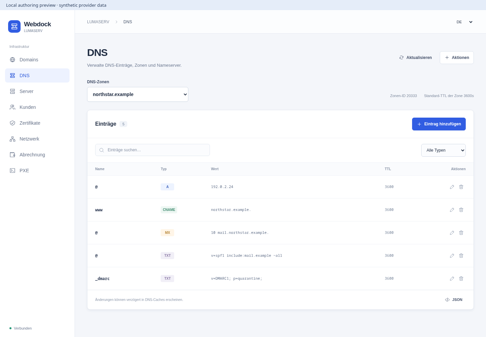
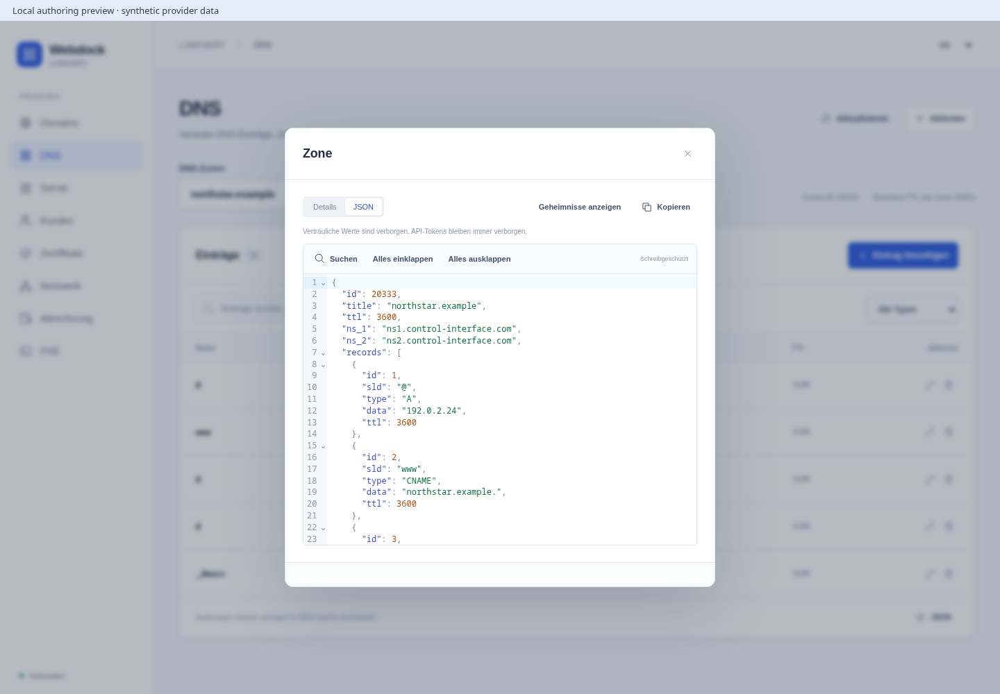
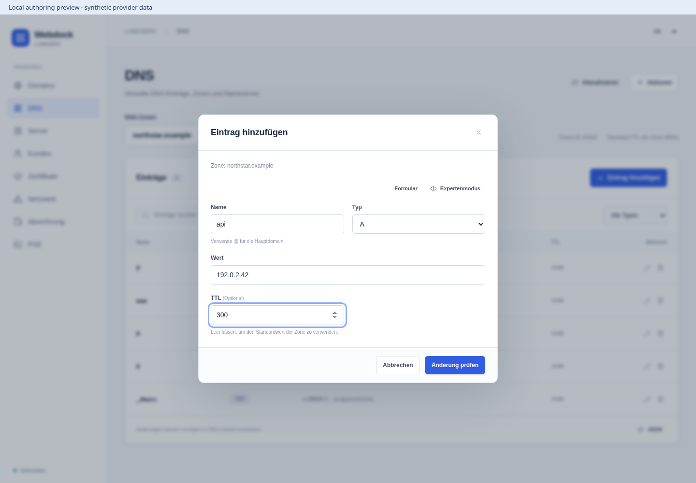
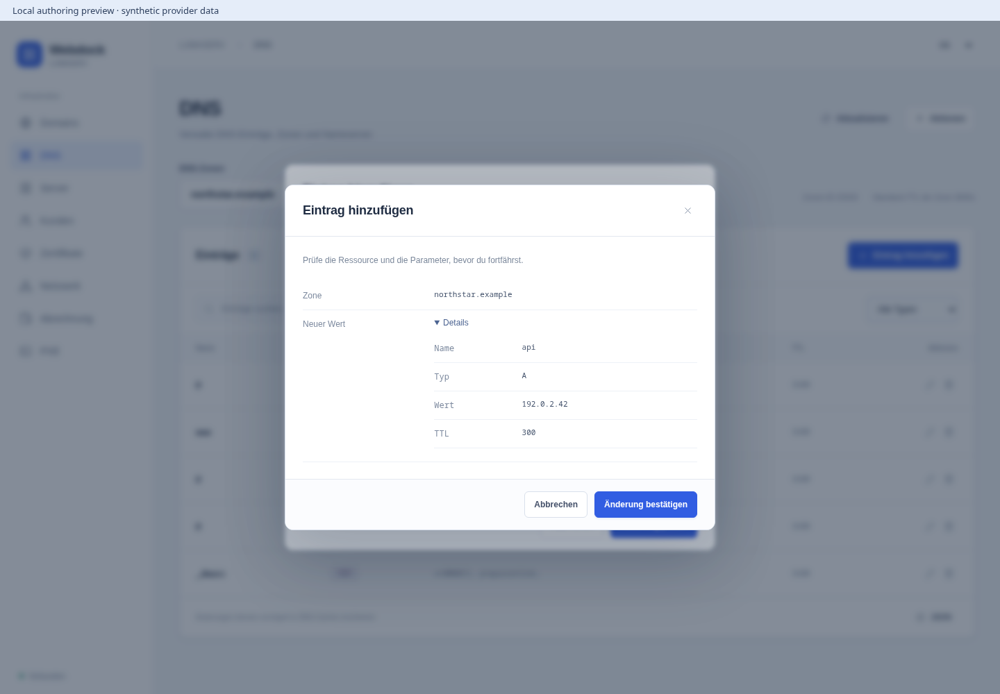
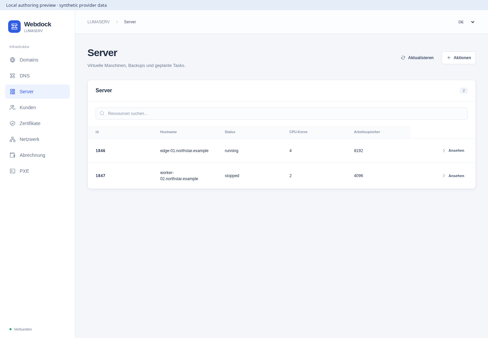
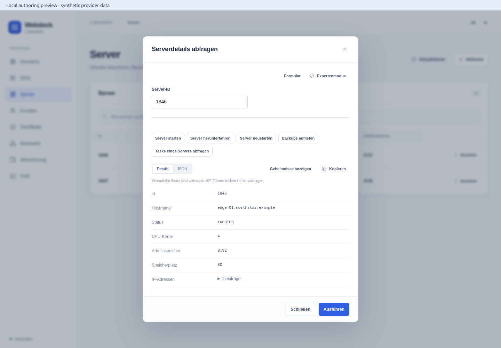
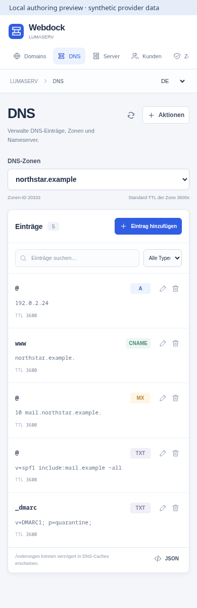

# LUMASERV for Webdock

An independent Webdock extension for the [LUMASERV API](https://docs.control-interface.com/). Manage domains, DNS records, servers, domain contacts, certificates, networking and billing from one project console.

**Version 0.1.0-alpha.2 — operator-configured integration.** Provider contracts are checked against the documentation and official PHP client. No live account, paid order or destructive provider operation was used during development. This is not a production compatibility certification.

## The experience

- A normal DNS console: choose a zone, search records, edit name/type/value/TTL and review changes. JSON is optional.
- Resource categories and searchable actions for the complete documented API: 55 operations are also declared for Webdock API and MCP access.
- An optional CodeMirror JSON workbench with syntax highlighting, validation, line numbers, folding, search and formatting.
- Readable resource results, explicit loading/empty/error states and deliberate confirmation before changes.
- Credentials concealed by default. The API token is never sent to the browser.





<details>
<summary>More screenshots: DNS editing, servers and mobile</summary>

All images below show the real plugin UI in the local authoring preview with synthetic data.











</details>

DNS changes are not atomic at this provider: editing creates the replacement first, then deletes one exact old match. If the second step fails, the UI reports the remaining old record. Inspect and refresh before retrying. Deletion requires exact name/type/value and optionally TTL, with `limit=1`; identical duplicate records are indistinguishable at the provider endpoint.

## Coverage

Domains: list/search, register, transfer, availability, update, delete/undelete and prices. Contacts: list/search, create and update. Nameservers: list/search, create and refresh. DNS: list/create/read zones, add/delete records. SSL: inventory, orders with/without CSR, refunds and approvers. KVM: inventory/order/details, power actions, reinstall, configuration, deletion, backups, tasks, schedules, VNC and graphs. Networking: rDNS, traffic and DDoS alerts. Account balance, payment links/details and PXE creation/details are included.

The linked API has **no documented customer-account CRUD**. Domain contacts and `filter_username` provide the documented customer-related functions. Account administration stays in the LUMASERV partner portal. Filters are not tenant isolation.

## Install and connect

1. Submit/install the `extension` manifest from `tabularium.json` through Webdock Registry. The release references an immutable OCI image.
2. Provision one private runtime per installation/project in your approved EU infrastructure. Pin its image digest, project ID and runtime generation. Grant only intended project users access to this extension. For an operator-wide LUMASERV account, use an operator-only Webdock project; never attach that account to an ordinary customer's project.
3. Mount a dedicated provider key as a read-only secret file, and set `LUMASERV_API_TOKEN_FILE`. Do not place provider credentials in the manifest, plugin configuration or UI. The declared secret name is `lumaserv-api-token`; mounting the file is an operator setup step, not automatic provisioning claimed by this plugin.
4. Set the runtime variables listed in `.env.example`: host-issued runtime credential, trusted host public key file, exact project ID/generation, host callback origin, Console origin and TLS files.
5. Keep **HTTPS 3443 private**, reachable only by Webdock. Expose the static UI on **3444** through your HTTPS ingress; it has no provider/runtime API routes. Restrict runtime egress to the trusted Webdock callback and `partner.lumaserv.com:443`. Use verified TLS and a non-root, read-only container.
6. Open LUMASERV from the project's plugin navigation and test the connection. The balance lookup is read-only.

The default host origins in `.env.example` are examples, not discovery. Use the actual callback and Console origins of your deployment. Rotate the provider token at LUMASERV and replace the mounted secret/restart the runtime. Rotate host authority using a new generation and runtime credential.

### Why a dedicated provider transport?

The currently vendored Webdock HTTP binding supports header credentials and JSON bodies. This legacy provider requires query-token authentication and PHP-form bodies. The plugin therefore uses a fixed-origin server transport, never arbitrary user URLs. It validates the signed plugin/action/project/generation, rechecks live host authority with the SDK's scoped data service before every provider call, and pins the runtime to `WEBDOCK_PLUGIN_PROJECT_ID`.

The data service's `connection` read is an authority check only; no provider secret or customer data is stored there. Direct transport requires the operator's explicit egress/secret setup above. This is not a claim that the Core HTTP binding supports form/query-token injection.

## Security and operation boundaries

The iframe communicates only through Webdock's nonce-bound MessagePort. It makes no direct network requests. Runtime actions require the host runtime bearer credential and a signed, unexpired invocation for the matching action, project and generation. Mutating actions require an operation-specific confirmation in their strict input schema. Replayed write invocation IDs are rejected during their validity window in the running process; no cross-restart idempotency is promised.

Only the fixed HTTPS API origin is used. Redirects and retries are disabled. Provider calls have a 30-second timeout and a 4 MiB response cap. Error bodies, token-bearing URLs and submitted values are not reflected in errors or logged. After any ambiguous timeout, check provider state before trying again. External HTTP tracing must redact `api_token` query parameters.

Orders can incur charges; reinstalls, restores and deletes can destroy data. No paid or destructive action is run simply by opening the interface. Generated server passwords or certificate keys can be revealed in a response; save them before navigating away. No credentials or results are persisted in browser storage.

## Compatibility notes

Checked against the [documentation](https://docs.control-interface.com/) and [official PHP client](https://github.com/LUMASERV/lumaserv-php-client/tree/master/src) on 2026-10-18. Where those disagree, the concrete SDK wire format is used:

- Authentication: `api_token` query parameter and write form body; nested data uses PHP bracket syntax, booleans use `1`/`0`.
- Contact update requires `handle`, omitted in the documentation table.
- DNS deletion uses `records[0]` and a one-record limit.
- Server tasks use GET; scheduled-task writes use singular `scheduledTask` paths.
- rDNS uses POST and `ip`; the form's `address` is translated. Empty rDNS removes it.
- PXE creation uses POST.
- Payments use `transaction_amount` and `ok_url`.

Old OS examples in the provider docs are not a current template catalog. Select provider-supported templates; this extension does not default to an obsolete OS.

## Develop and verify

Use Bun and Node 24. The SDK is vendored from the matching Webdock extension SDK; dependencies are locked. The source does not depend on the Webdock monorepo.

```sh
bun install --frozen-lockfile --ignore-scripts
bun run build
bun run test
bun run test:browser
bun run preview
```

The preview runs locally at `http://127.0.0.1:3494`. It embeds the **real UI in an `allow-scripts` sandbox**, uses the signed runtime, and supplies clearly labeled synthetic provider data. It never contacts LUMASERV. Browser screenshots in this repository are from that authoring preview, not a production account.

Tests cover all operation paths/encodings, signed runtime scope, authority revocation, confirmation and replay guards, malicious parameters, secret-safe failures and manifest consistency. The image smoke check validates non-root/read-only startup, TLS health, the UI assets and separation of public UI/private actions.

Builds are local; no non-EU hosted build workflow is enabled. The registry is a distribution listing, not a deployment of the runtime or a provisioned LUMASERV account.

## License

MIT. CodeMirror and its language packages are MIT-licensed; the vendored Webdock SDK and its dependency licenses remain applicable. This is an integration for LUMASERV, not an official LUMASERV product.

### Release verification (2026-10-18)

24 unit/contract/security tests and 9 real-browser sandbox tests passed. The
browser tests cover DNS add/delete, partial replacement failure, failed zone
switches, synchronized form/JSON drafts, highlighted read-only responses and
320/375/414/768px layouts. TypeScript, the UI bundle build and the final container
smoke check passed. A second review confirmed both zone-state and editor-state
findings were fixed. Provider live compatibility and an installed Core deployment
remain unverified; the screenshots show only the local authoring harness.

For the browser suite, install Chromium with `bunx playwright install chromium`.
An existing local binary can be selected using `PLAYWRIGHT_EXECUTABLE_PATH`.
For container validation, build `webdock-lumaserv:0.1.0-alpha.2` locally,
then run `bun run test:image`. Both tests create only disposable local fixtures.

## EU CI

Source pushes and trusted same-repository pull requests run the frozen dependency install, build and unit tests through the dedicated rootless EU builder. External fork PRs cannot run on this persistent trusted runner. No hosted fallback, Docker daemon or provider/customer credentials are used.

The manual `Plugin EU build` workflow can push a checked image candidate by enabling `publish_image`. It records the immutable image/source identity; existing versioned registry manifests and releases are unchanged. A new registry version still requires its proper manifest and signed integrity verification.
